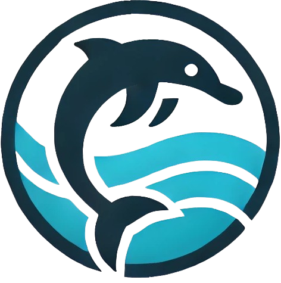
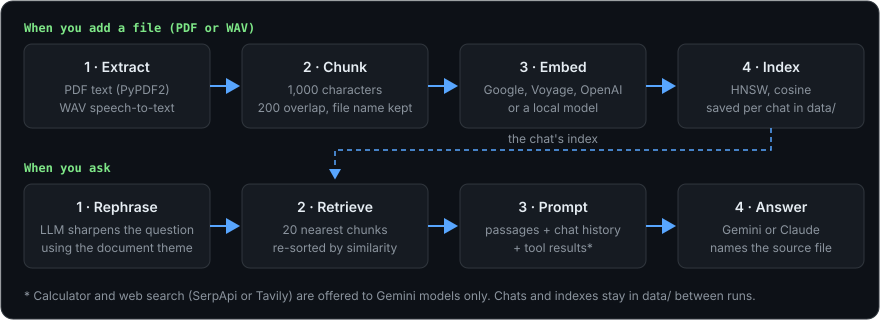
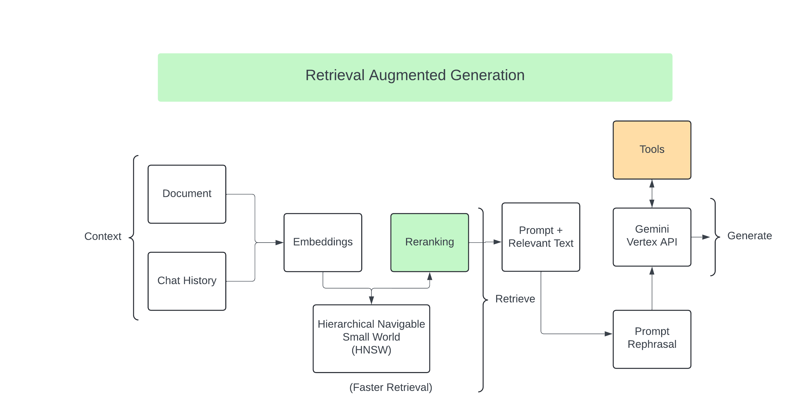
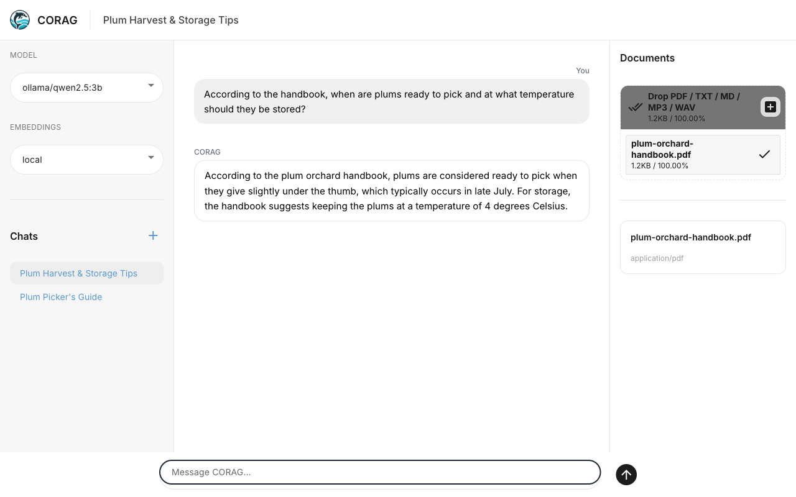

<div align="center">



# CORAG

### Chat with your PDFs and voice recordings in your browser.

**Open-source RAG chat app for PDF and audio documents, written in Python with NiceGUI.** Upload files, ask questions in plain language and get answers from Google Gemini or Anthropic Claude that name the file they came from, with HNSW vector search, cloud or local embeddings, and chats that are still there after a restart.

[](LICENSE)
[](requirements.txt)

[**Quick start**](#quick-start) · [Why CORAG](#why-corag) · [What it does](#what-it-does) · [How it works](#how-it-works) · [Screenshots](#screenshots) · [FAQ](#faq) · [Docs](#documentation)

```sh
git clone https://github.com/harinaralasetty/CORAG.git && cd CORAG
pip install -r requirements.txt   # inside a Python 3.13 virtual environment
cp .env.example .env              # then add a Gemini or Claude API key
python server.py                  # open http://localhost:8080
```



</div>

> [!NOTE]
> CORAG's code is open source, but the answers come from cloud models. You need a Google Gemini or Anthropic Claude API key, and each question is sent to that provider together with the matching passages from your files. Embeddings can run on your machine; audio is transcribed by Google's Web Speech service.

## Why CORAG

You have a stack of PDFs or recordings and want to ask them questions instead of scrolling through them.

- **Ask across several files.** Add as many PDFs or MP3 and WAV recordings to a chat as you like and ask about them together. Every passage is labelled with its file name, so answers can say where they came from.
- **Pick your model.** Switch between Gemini and Claude models from a dropdown, per question.
- **Embeddings without a key.** Use Google, Voyage or OpenAI embeddings, or a local sentence-transformers model that needs no API key.
- **Chats survive restarts.** Chats, their file lists and their search indexes are saved in a local `data/` folder.
- **Tools when they help.** Gemini models can call a calculator and an optional web search (SerpApi or Tavily).
- **Small, readable code.** Plain Python modules for ingestion, retrieval, inference and tools, with tests that need no API keys.

## Quick start

**You need** Python 3.13 (the version the dependencies are pinned and tested on) and an API key from [Google AI Studio](https://aistudio.google.com/) (Gemini) or the [Anthropic Console](https://console.anthropic.com/) (Claude).

**1. Get the code and install it** in a virtual environment:

```sh
git clone https://github.com/harinaralasetty/CORAG.git
cd CORAG
python -m venv .venv
source .venv/bin/activate        # Windows: .venv\Scripts\activate
pip install -r requirements.txt
```

**2. Add your key.** Copy the example settings file, open `.env` in a text editor and fill in `GOOGLE_API_KEY` or `ANTHROPIC_API_KEY`:

```sh
cp .env.example .env
```

**3. Start it** and open [http://localhost:8080](http://localhost:8080):

```sh
python server.py
```

**4. Use it.** Drop a PDF, MP3 or WAV file into the **Documents** panel on the right, wait for "Processed", then type a question. Pick the model and embedding provider in the left panel; start a new chat with **+**.

<details>
<summary><b>Settings, models, storage and tests</b></summary>

<br>

**Environment variables** (in `.env`, see [`.env.example`](.env.example)):

| Variable | What it does |
| --- | --- |
| `GOOGLE_API_KEY` | Gemini models and Google embeddings. |
| `ANTHROPIC_API_KEY` | Claude models. At least one of these two keys is needed to chat. |
| `VOYAGE_API_KEY`, `OPENAI_API_KEY` | Voyage or OpenAI embeddings. |
| `SEARCH_PROVIDER` | Web search tool: `serpapi` (default, needs `SERPER_API_KEY`) or `tavily` (needs `TAVILY_API_KEY`). Optional. |
| `CORAG_DATA_DIR` | Where chats and indexes are stored. Default `data`. |

**Defaults.** The default model is `gemini-2.5-flash`, or `claude-haiku-4-5-20251001` when only an Anthropic key is set. The default embedding provider is the first with a key in the order Google, Voyage, OpenAI; with none, the local `sentence-transformers/all-MiniLM-L6-v2` model is used (downloaded on first use).

**Models in the picker** (`models_list` in [`config.py`](config.py)): `gemini-2.5-flash`, `gemini-2.5-pro`, `gemini-2.5-flash-lite`, `gemini-2.0-flash`, `gemini-flash-latest`, `gemini-pro-latest`, `claude-haiku-4-5-20251001`, `claude-sonnet-4-6`, `claude-opus-4-7`.

**Embedding models** ([`retrieval/embeddings_router.py`](retrieval/embeddings_router.py)): Google `models/gemini-embedding-001`, Voyage `voyage-3-lite`, OpenAI `text-embedding-3-small`, local `sentence-transformers/all-MiniLM-L6-v2`. A chat keeps the embedding provider it started with; pick another one in a new chat.

**Chunking and search** ([`config.py`](config.py)): chunks are 1,000 characters with 200 overlap (`CHUNK_SETTINGS`); the HNSW index uses `M=30`, `ef_construction=500`. The first 2,000 characters of a file (`THEME_LENGTH`) guide question rephrasing.

**Uploads.** Up to 200 MB per file, several files per chat. Uploading a file with the same name twice in a chat is skipped.

**Storage.** Chats are saved in `data/chat_threads_info.json` and each chat's index in `data/<chat id>/`. Delete the `data/` folder to start fresh.

**Dependencies.** [`requirements.txt`](requirements.txt) lists the direct dependencies; [`requirements-lock.txt`](requirements-lock.txt) has the exact pinned set. `google_search_results` provides the `serpapi` module; do not also install the separate `serpapi` package, it conflicts.

**Tests:**

```sh
pip install -r requirements-dev.txt
pytest
```

The tests use fake embeddings and models, so they need no API keys.

</details>

## What it does

| Area | Details |
| --- | --- |
| **Documents** | PDF text extraction with ligature and line-break cleanup; MP3 and WAV speech-to-text; several files per chat |
| **Retrieval** | Question rephrased by the model, HNSW cosine search over 1,000-character chunks, top 20 re-sorted by similarity |
| **Answers** | Nine Gemini and Claude models; prompts carry passages, file names and chat history, and ask the model to name its sources |
| **Embeddings** | Google, Voyage, OpenAI or a local sentence-transformers model |
| **Tools** | Arithmetic-only calculator and web search via SerpApi or Tavily (Gemini models) |
| **Chats** | Automatic chat names, chat list, per-chat documents, saved to disk between runs |

## How it works

<div align="center">

</div>

- An agent (`inference/inference_manager.py`) handles each question: it rephrases it, embeds it, pulls the closest passages from the chat's index and builds one prompt with the passages, file names and earlier messages.
- Gemini models can call the calculator or web search; the tool output is added to the prompt and the model is asked again. Claude models get the prompt without tools.
- Retrieval always sends up to 20 passages, and answers are only as good as the extracted text: there is no OCR for scanned PDFs.

More detail in [Architecture](docs/architecture.md).

## Screenshots



This screenshot is from an earlier Streamlit version of CORAG. The current NiceGUI interface has the same parts in a three-column layout: models, embeddings and chats on the left, the conversation in the middle, documents on the right.

## FAQ

**Is it free?** The code is free under Apache-2.0. Google, Anthropic and the optional embedding and search providers bill API use under their own pricing.

**Does my data leave my computer?** Yes, for answers: your question and the retrieved passages go to Gemini or Claude, and audio goes to Google's Web Speech service. Extracted text, chats and indexes are stored only in the local `data/` folder. With the local embedding model, document text is not sent anywhere for embedding.

**Which files can I upload?** PDFs with a text layer, and MP3 or WAV audio (MP3 files longer than 60 minutes are refused). Scanned PDFs need OCR first.

**Can I change the embedding provider in an existing chat?** No. Vectors from different providers cannot be mixed, so a chat keeps its first provider. Start a new chat to use another.

**Why don't Claude models use the calculator or web search?** Tools are wired through LangChain for Gemini only; Claude gets a plain prompt.

**Can several people share one instance?** It is built as a single-user local app: every open browser tab sees the same chats.

## Documentation

- [Architecture](docs/architecture.md): source layout, ingestion and question flow, limits
- [Settings file example](.env.example)
- [Configuration](config.py) and [prompts](prompts/)

## Contributing

Issues and pull requests are welcome. Run `pytest` (after `pip install -r requirements-dev.txt`) before opening a pull request; the tests need no API keys. Questions or feedback: [Hari Naralasetty on LinkedIn](https://www.linkedin.com/in/harinaralasetty/).

## License

[Apache-2.0](LICENSE)
